# Домашняя работа: замеры времени и памяти алгоритмов

**Среда:** Python 3.14.7, Linux. Все значения получены локальным запуском `python3`; время измерялось через `time.perf_counter()`, а пиковые выделения Python — через `tracemalloc`. Поэтому результаты могут отличаться на другой машине или при следующем запуске.

## 1. Первый замер — `02_first_measurement.py`

Измерялось время суммирования чисел от 0 до 999 999 циклом `for`. Результат: **0.050312 сек**.

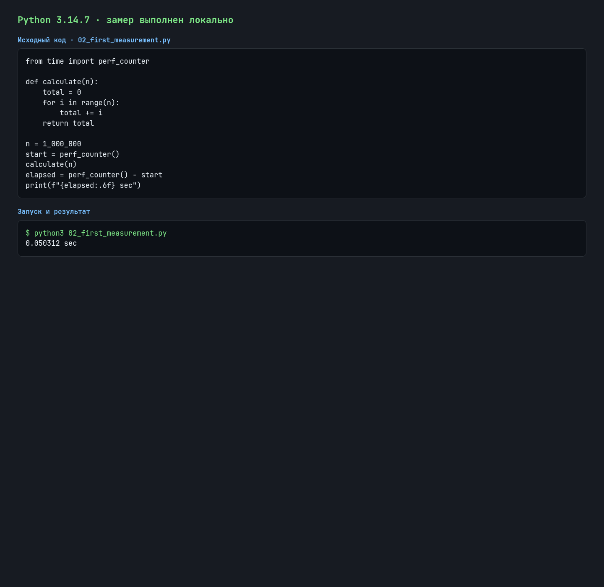

Вывод: это линейный алгоритм: при увеличении числа элементов время должно расти примерно пропорционально `n`.

## 2. Рост времени линейного алгоритма — `03_growth_experiment.py`

Измерялось время той же функции на входах 10 000, 100 000, 1 000 000 и 10 000 000: **0.000425, 0.005055, 0.053351 и 0.533119 сек**.

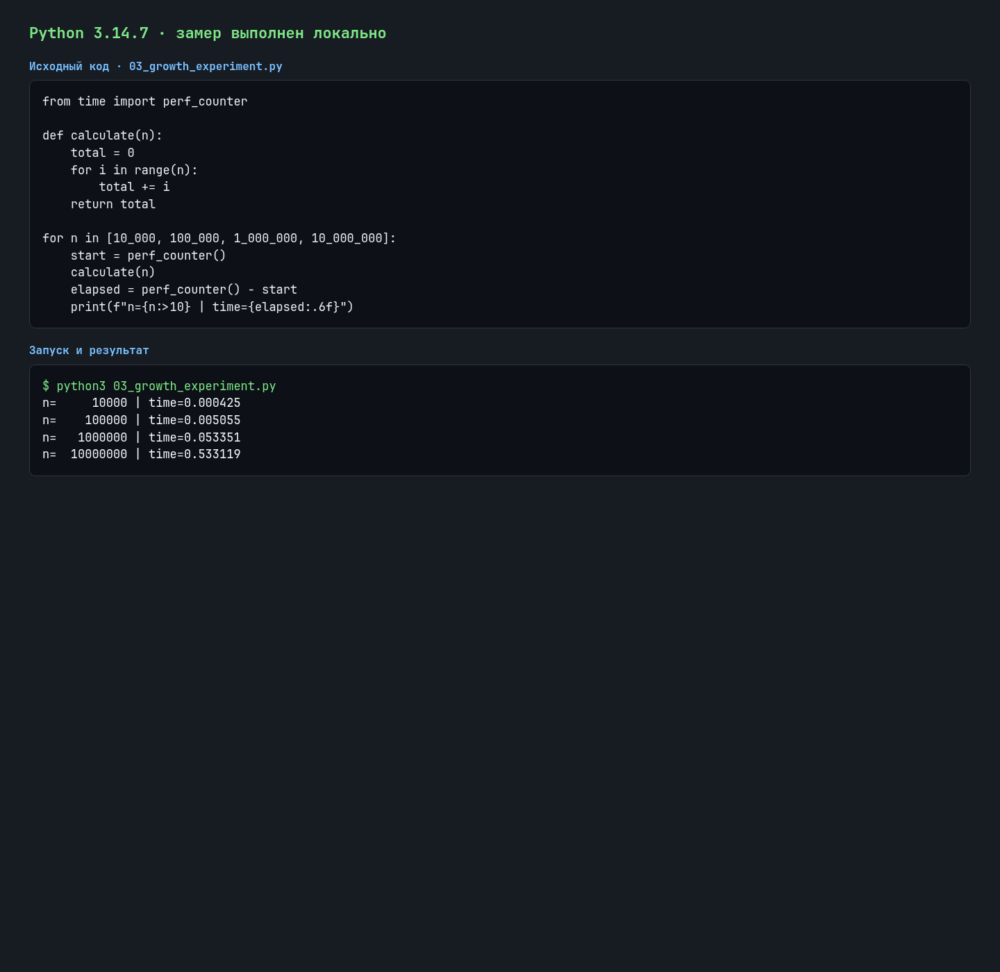

Вывод: увеличение `n` в 10 раз увеличивало время примерно в 10 раз. Эксперимент подтверждает сложность `O(n)`.

## 3. Доступ по индексу — `04_constant_access.py`

Измерялся доступ к среднему элементу списка для размеров от 1 000 до 1 000 000. Медианные значения: **0.1800, 0.1950, 0.1760 и 0.1755 мкс**.

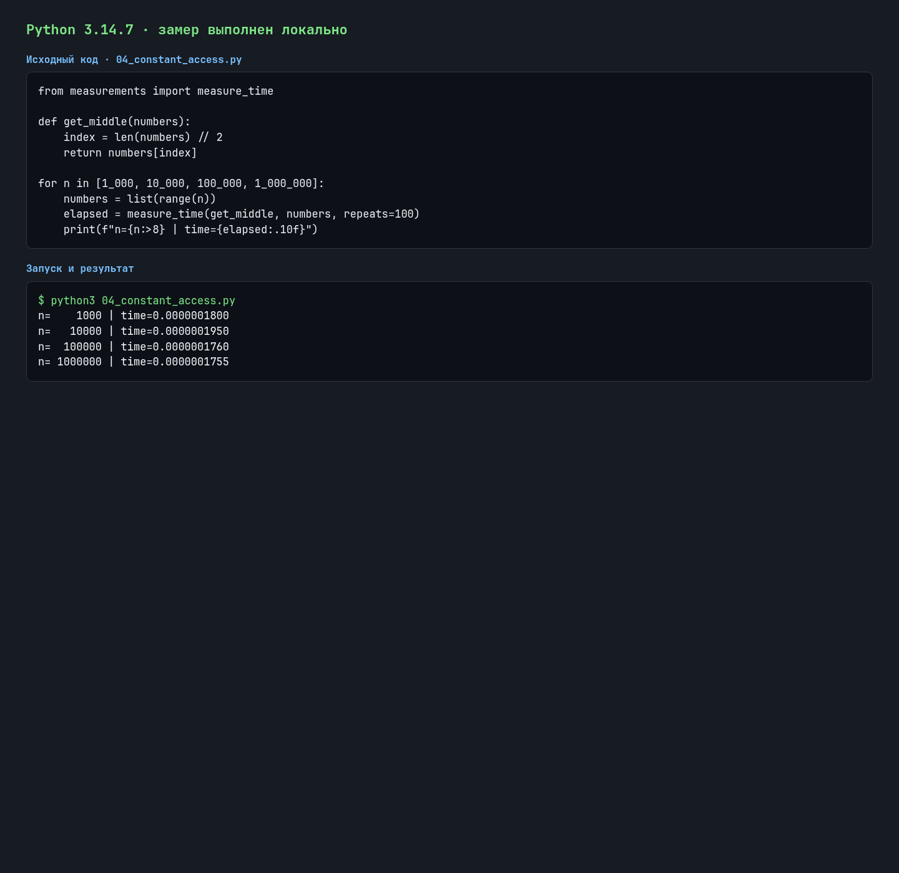

Вывод: время практически не меняется с размером списка, поскольку элемент находится сразу по индексу. Это `O(1)`.

## 4. Линейный поиск — `05_linear_search.py`

Измерялся поиск отсутствующего элемента в списках из 10 000, 100 000 и 1 000 000 чисел: **0.000164, 0.001722 и 0.018736 сек**.

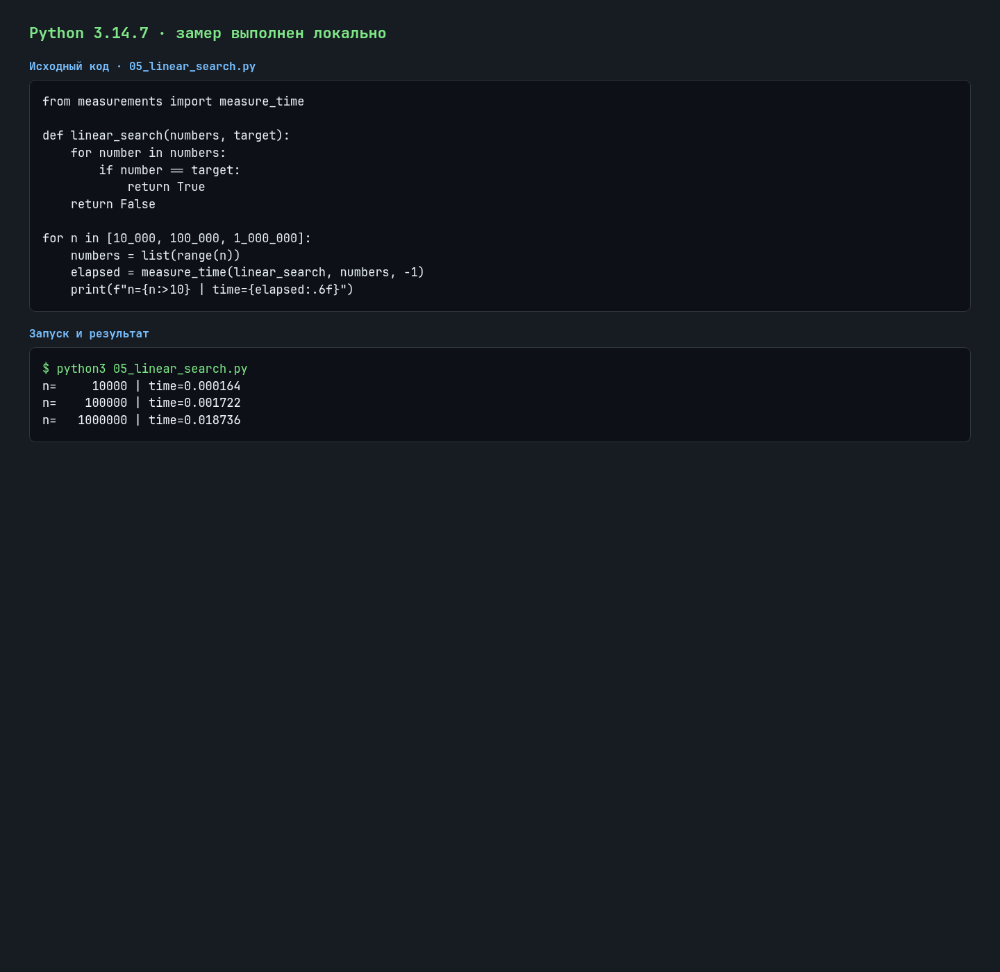

Вывод: отсутствующий элемент заставляет просмотреть весь список. При десятикратном росте входа время возрастает примерно в 10 раз — `O(n)`.

## 5. Квадратичный алгоритм — `06_quadratic.py`

Измерялось выполнение двух вложенных циклов для `n = 100, 200, 400, 800`: **0.000294, 0.001193, 0.005448 и 0.025997 сек**.

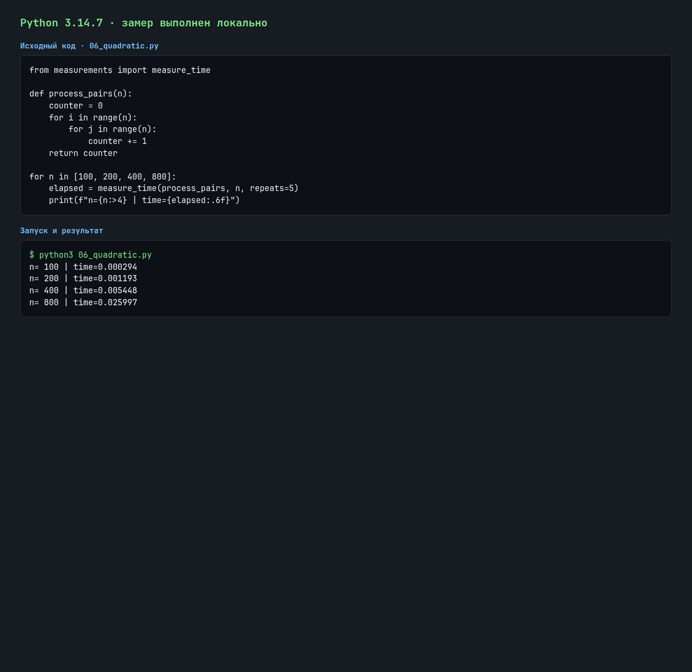

Вывод: при удвоении `n` время выросло примерно в четыре раза. Вложенные циклы дают сложность `O(n²)`.

## 6. Поиск в `list` и `set` — `07_list_vs_set.py`

Измерялось отсутствие `-1` в коллекциях из 1 000 000 элементов: `list` — **0.011680 сек**, `set` — **0.000000118 сек**.

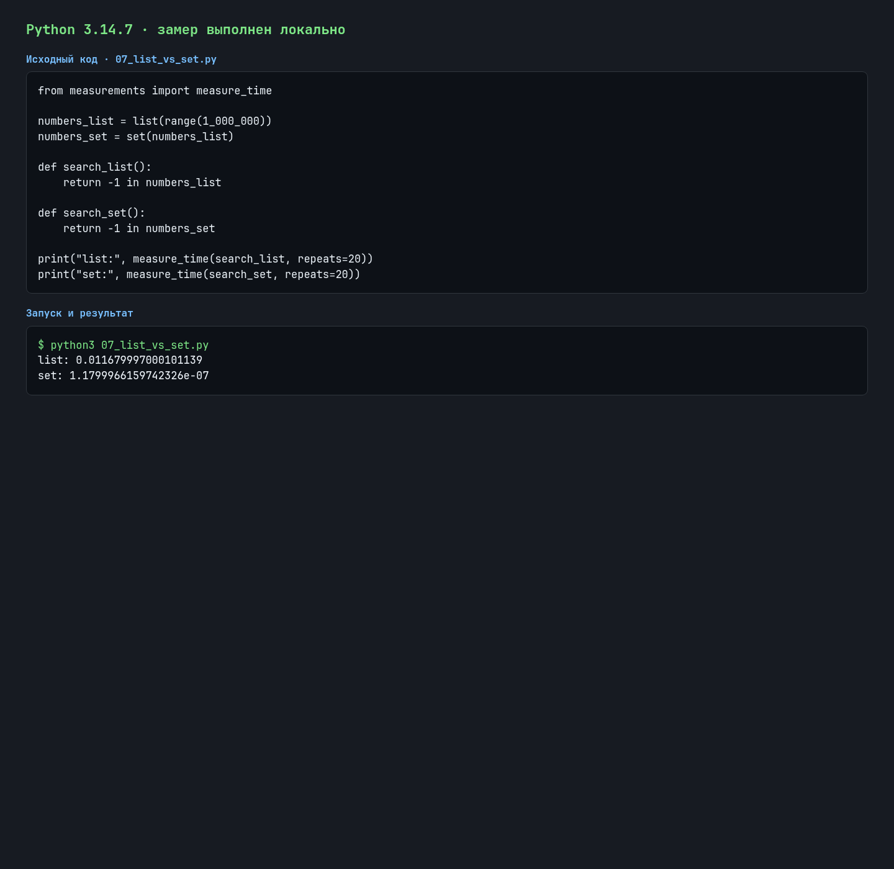

Вывод: список ищет последовательно, а хеш-таблица `set` в среднем находит элемент за `O(1)`. Поэтому `set` оказался на несколько порядков быстрее.

## 7. Поиск дубликатов — `10_final_experiment.py`

Сравнивались два варианта поиска дубликатов на уникальных списках. При `n = 4000` вложенные циклы заняли **0.311182 сек**, а вариант с множеством — **0.000193 сек**; пик памяти составил соответственно **0.000000 MiB** и **0.156456 MiB**.

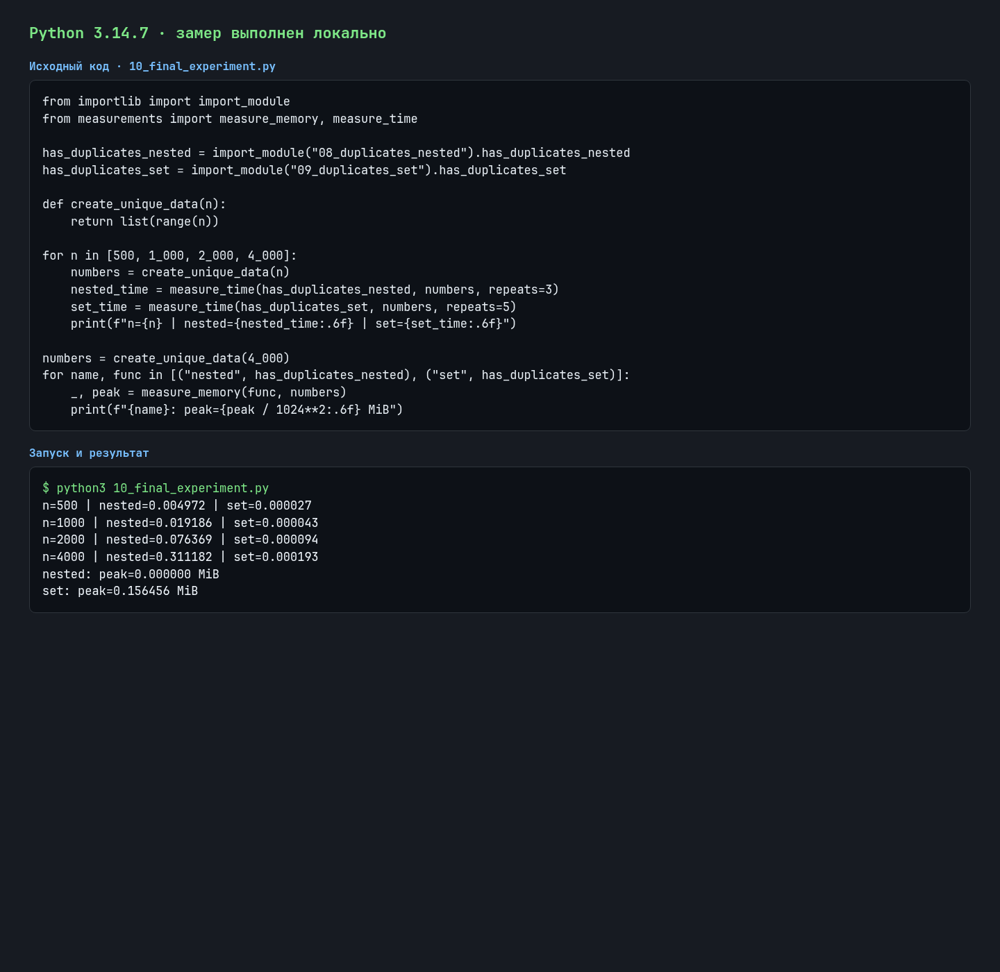

Вывод: вложенное сравнение имеет `O(n²)` и почти не требует дополнительной памяти. Множество расходует `O(n)` дополнительной памяти, но уменьшает ожидаемое время до `O(n)`.

## 8. Ручная сумма и встроенная `sum()` — `11_sum_comparison.py`

Измерялось суммирование списка из 1 000 000 чисел: ручной цикл — **0.043988 сек**, `sum()` — **0.006555 сек**.

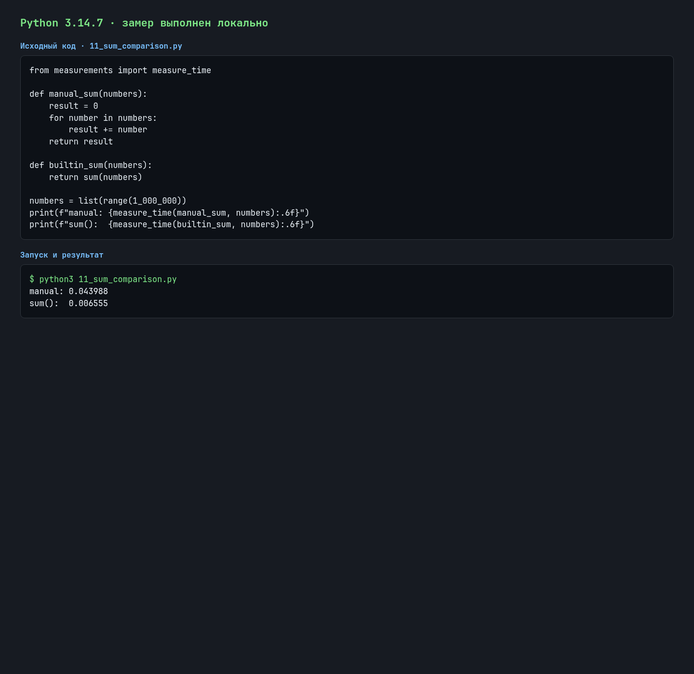

Вывод: обе версии имеют `O(n)`, но встроенная функция заметно быстрее из-за оптимизированной реализации и меньших накладных расходов Python-цикла.

## 9. Сравнение памяти — `12_memory_comparison.py`

Измерялся пик выделений при суммировании квадратов 1 000 000 чисел. Версия со списком заняла **38.573151 MiB**, версия с накопителем — **0.000099 MiB**.

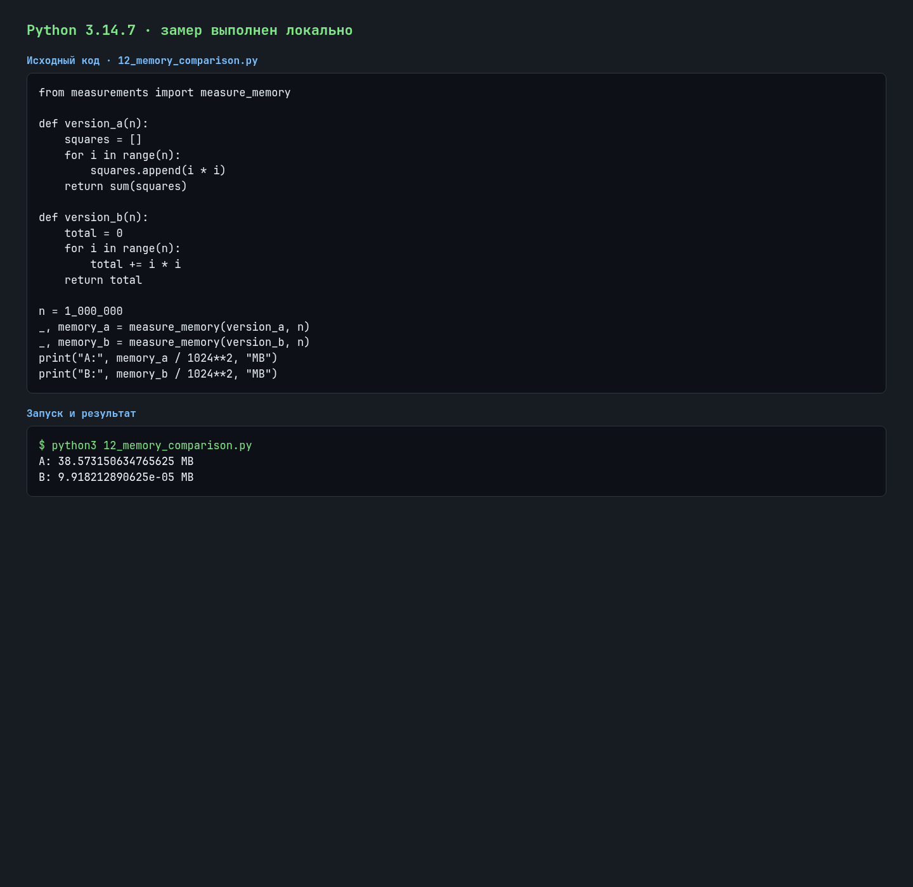

Вывод: обе функции выполняют одинаковую работу, но хранение всех квадратов требует линейной дополнительной памяти. Накопитель хранит лишь текущее значение, то есть использует `O(1)` памяти.

## 10. Список и генератор — `13_list_generator.py`

Измерялись время и память суммирования квадратов. Для `n = 1 000 000` список: **0.086313 сек, 38.571381 MiB**; генератор: **0.101854 сек, 0.000389 MiB**.

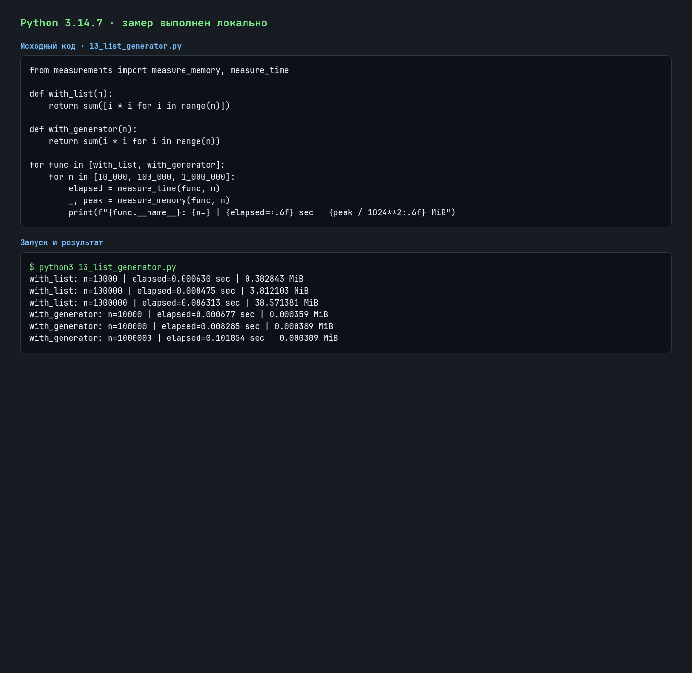

Вывод: генератор не создаёт полный промежуточный список и почти не расходует дополнительную память. В этой серии он немного медленнее, но выигрыш по памяти очень велик.

## 11. Повторные запуски — `14_repeated_runs.py`

Семь запусков суммирования 1 000 000 чисел дали значения от **0.055073** до **0.077404 сек**; медиана — **0.061933 сек**.

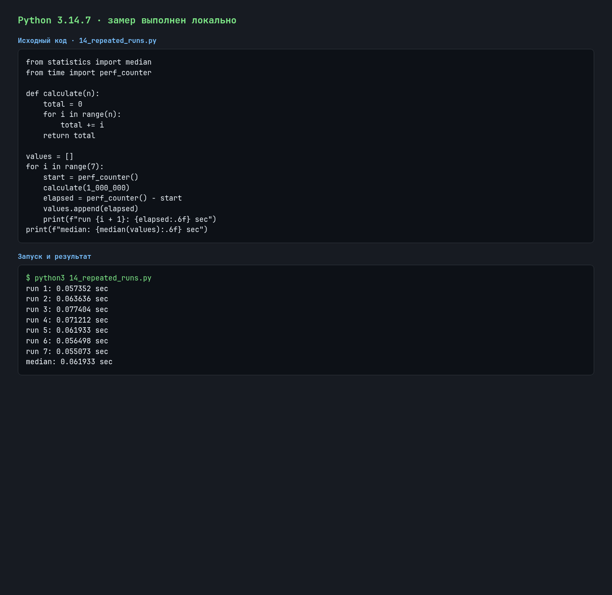

Вывод: одиночные замеры колеблются из-за состояния системы и интерпретатора. Медиана устойчивее отдельного измерения, поэтому она лучше подходит для сравнения.

## Итог

Эксперименты показали различие между `O(1)`, `O(n)` и `O(n²)`, а также компромисс между временем и памятью. Для измерений важны одинаковые входные данные, несколько повторов и понимание того, что `tracemalloc` показывает выделения Python, а не всю память процесса.
